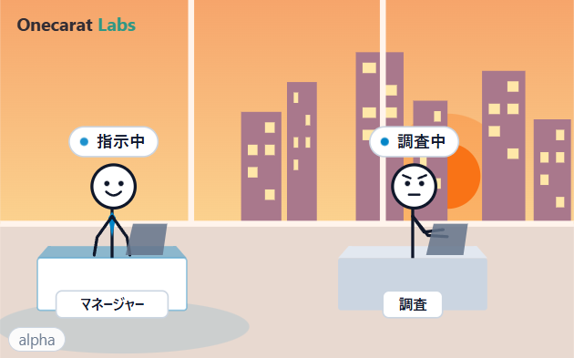
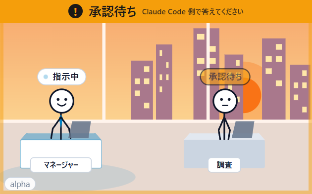
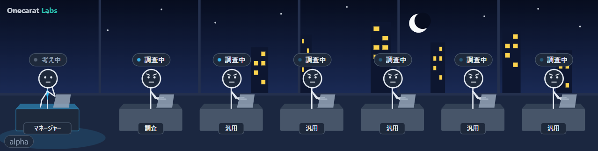

# Onecarat Agent Office

日本語 | [English](README.md)

Claude Code が働いている様子を、画面の右上に出る小さな窓で眺めるためのツールです。メインのエージェントと、Claude Code が実際に起動したサブエージェントが、棒人間になってオフィスで働きます。

**見るだけの小窓です。** 窓から Claude Code に入力したり、承認したりはできません。操作するのは、これまでどおり PowerShell 側の Claude Code です。



| 承認待ち | 夜 |
|---|---|
|  |  |

## できること

- **エージェントの動きが見える。** 考えている、ファイルを調べている、編集している、コマンドを実行している、報告している、といった様子が、棒人間のしぐさと小さな札でわかります。
- **承認待ちが一目でわかる。** Claude Code が承認を待って止まると、窓の上に「承認待ち」の帯が出て、窓のまわりにオレンジ色の枠が点滅します。タイトルバーにも表示されます。
- **日本語と英語。** Windows の表示言語が日本語なら日本語で、それ以外なら英語で表示します。自動で決まり、切り替えの設定はありません。
- **時刻で背景が変わる。** PC の時計に合わせて、朝・昼・夕方・夜と切り替わります。
- **タスクバーにしまえる。** ふつうのアプリと同じように、最小化のボタンでタスクバーにしまい、タスクバーから戻せます。しまっている間に承認待ちになると、タスクバーのボタンが光って知らせます。最大化のボタンは灰色で見えますが、使えません（Windows の標準の枠は、最小化を有効にすると最大化も並べて描くためです）。
- **窓は動かせて、大きさも変えられる。** 大きくすると、机の数が増えます。入りきらないサブエージェントは「+3」のように数で示します。
- **セッションごとに窓が 1 枚。** Claude Code を 4 つ動かせば、小窓が 4 枚並びます。どの窓がどのセッションかは、タイトルバーと左下のフォルダ名でわかります。
- **常に最前面。** ほかの窓の下に隠れません。新しい窓が出ても、キーボードの入力先は奪いません。

## やらないこと

この版は「見るだけの小窓」に範囲を絞っています。次のことはできません。

- 小窓からの入力・依頼・送信
- 小窓からの承認・拒否
- セッションの内容（指示文、出力、ファイルの中身）の保存。イベントはメモリ上にだけ置き、窓を閉じると消えます
- モデルの呼び出し、外部への通信
- macOS / Linux での動作（Windows 専用です）
- ブラウザのタブでの表示（以前の版の機能です。後述）

## 必要なもの

- Windows 10 / 11
- Claude Code
- Node.js 18 以上（入っていない場合は `winget install OpenJS.NodeJS.LTS`）

## 導入

PowerShell で次の 2 行を実行します。

```powershell
claude plugin marketplace add onecarat-labs/onecarat-agent-office
claude plugin install onecarat-agent-office@onecarat
```

そのあと、Claude Code を起動し直してください。

## 起動と終了

Claude Code の中で、次のどちらかを入力します。

```
Onecarat Agent Office を起動して
```

```
/onecarat-agent-office:office start
```

画面の右上に小窓が開きます。あとは、いつもどおり Claude Code を使うだけです。

| したいこと | 入力 |
|---|---|
| 起動する | `/onecarat-agent-office:office start` |
| 終了する | `/onecarat-agent-office:office stop`（または、小窓をすべて閉じる） |
| 動いているか確かめる | `/onecarat-agent-office:office status` |
| 環境を確かめる | `/onecarat-agent-office:office check` |

覚えておくとよいこと:

- **最後の小窓を閉じると、アプリも終了します。** もう一度見たいときは、起動し直してください。
- **セッションが終わると、その窓は自動で閉じます。** 棒人間がお辞儀をして手を振ってから閉じます。
- **自分で閉じた窓は、そのセッションの間は勝手に開き直しません。** もう一度出したいときは、起動の操作をもう一度行ってください。
- 起動した直後は、最初のイベントが届くまで「Claude Code の動きを待っています」と表示されます（英語では「Waiting for Claude Code…」）。

## 小窓の見かた

| 見た目 | 意味 |
|---|---|
| ネクタイをした棒人間（左） | メインのエージェント（マネージャー） |
| 右側の机の棒人間 | Claude Code が実際に起動したサブエージェント |
| 札「考え中」 | 次に何をするか考えている |
| 札「調査中」「編集中」「実行中」「テスト中」「調べ中」 | ファイルを読む、書きかえる、コマンドを動かす、テストを動かす、Web を調べる |
| 札「指示中」 | マネージャーがサブエージェントに仕事を頼んでいる |
| 札「承認待ち」（オレンジ色）と、窓の上の帯・まわりの枠 | **Claude Code があなたの承認を待っています。** Claude Code 側で答えてください |
| 札「やり直し中」、汗 | 道具が失敗して、やり直している |
| マネージャーのところへ歩いていって、ハイタッチ | サブエージェントが報告を終えた（成功したかどうかは、イベントからの推定です） |
| お辞儀をして出ていく | サブエージェントの仕事が終わった |
| 右上の「+3」 | 窓に入りきらないサブエージェントが、ほかに 3 人働いている。窓を広げると見えます |

背景は、PC の時計で切り替わります。朝は 5 時から、昼は 10 時から、夕方は 16 時から、夜は 19 時からです。

英語で表示しているときの札は、Thinking（考え中）、Reading（調査中）、Editing（編集中）、Running（実行中）、Testing（テスト中）、Research（調べ中）、Delegating（指示中）、Needs OK（承認待ち）、Retrying（やり直し中）です。窓の上の帯は「Needs your approval」と出ます。

### 承認待ちの表示が残るとき

利用者が「拒否」を選んだことは、Claude Code から知らされません。そのため、拒否したあとも「承認待ち」の表示が残ります。

- 拒否したあと Claude Code が作業を続けた場合は、数秒で消えます。
- 拒否と同時に作業が中断された場合は、次の依頼を送るまで残ります。

## Hook の有効化と解除

小窓は、Claude Code の Hook（決まった場面でコマンドを呼ぶ仕組み）からイベントを受け取っています。

- **有効にする**: 上の「導入」でプラグインを入れると、プラグインの Hook が有効になります。このツールが、あなたの設定ファイル（`settings.json` など）を書き換えることはありません。
- **一時的に止める**: `claude plugin disable onecarat-agent-office@onecarat`（もう一度使うときは `enable`）
- **取り除く**:

  ```powershell
  claude plugin uninstall onecarat-agent-office@onecarat
  claude plugin marketplace remove onecarat
  ```

- **更新する**:

  ```powershell
  claude plugin marketplace update onecarat
  claude plugin update onecarat-agent-office@onecarat
  ```

Hook は、小窓アプリが動いていないときは何もしません（通信もしません）。動いているときも、Claude Code を待たせたり止めたりしないように、裏で動かす設定（`async`）にしてあります。どのイベントを使っているかは [docs/hook-events.md](docs/hook-events.md) にまとめています。

## 安全性について

- 待ち受けは自分の PC の中（`127.0.0.1`）だけです。外部には一切通信しません。
- Hook から送るのは、棒人間を動かすのに必要な項目だけです。作業の中身の文章は送りません。利用者が書いた依頼文、コマンド、ファイルの名前と中身、URL、検索の語句、道具の出力、エラーの文は、どれも送りません。コマンドについては「テストを動かすものかどうか」だけを送ります。送る文字は、Claude Code を動かしているフォルダの場所だけです（その最後の部分が、窓のタイトルになります）。
- 受け取ったイベントは、メモリ上にだけ置きます。ディスクには保存しません。
- 小窓から Claude Code へ何かを送る経路は、作っていません。
- 窓を表示する部品（Microsoft Edge WebView2）が、自分用のキャッシュを `%LOCALAPPDATA%\com.onecarat.agent-office` に作ります。セッションの内容は入りません。

しくみの説明は [docs/architecture.md](docs/architecture.md)、脆弱性の報告方法は [SECURITY.md](SECURITY.md) を見てください。

## うまくいかないとき

| 症状 | 確かめること |
|---|---|
| 小窓が出ない | `/onecarat-agent-office:office check` を実行して、表示を確かめてください |
| 「ポート … が使われています」と出る（英語では「port … is in use」） | 以前の版の Office が動いたままかもしれません。止めてから起動し直すか、`/onecarat-agent-office:office start --port 47822` を試してください |
| 窓は出るが、棒人間が動かない | プラグインを入れたあとに、Claude Code を起動し直しましたか。`claude plugin list` で有効になっているか確かめてください |
| 初めて起動したときに Windows の警告が出る | 小窓アプリ（`onecarat-agent-office.exe`）には、コード署名を付けていません。配布元を確かめたうえで判断してください |

## 以前の版（ブラウザのタブで開くオフィス）について

バージョン 0.3.0 までは、ブラウザのタブの中で、依頼の入力や調査（Research Lab）、設定の一覧表示までできる形でした。1.0 で「見るだけの小窓」に範囲を絞り、これらの機能は外しました。Claude Code の中身に踏み込む機能は、Claude Code の変化に合わせ続ける必要があり、作者が続けられなくなったためです。

以前の版は、公開リポジトリの `v0.3.0` 以前のリリースに残っています。

## 開発者向け

```powershell
npm ci
npm test              # イベントから状態への変換、画面のルール、起動スクリプトのテスト
npm run typecheck
npm run test:app      # 小窓アプリ（Rust）のテスト
npm run build:plugin  # 画面・アプリ・起動スクリプトをビルドして、プラグインの dist に置く
```

アプリのビルドには Rust（MSVC ツールチェーン）が必要です。構成:

| 場所 | 中身 |
|---|---|
| `packages/domain` | 状態の持ちかたと、イベントから状態への変換（どのツールにも依存しない部分） |
| `packages/adapter-claude-code` | Claude Code の Hook の入力を、上のイベントに直す部分 |
| `packages/office-ui` | 小窓の画面（React と SVG）。棒人間、背景、承認待ちの表示 |
| `packages/launcher` | 起動スクリプト（start / stop / status / check） |
| `src-tauri` | 小窓アプリ本体（Tauri、Rust）。Hook の受け口、セッションと窓の対応づけ |
| `plugin/onecarat-agent-office` | Claude Code のプラグイン（Hook の登録、転送スクリプト、スキル、ビルド済みの `dist`） |
| `tests/app` | 実物のアプリを別ポートで起動して確かめる検証（`npm run build:inspect` のあと `npm run check:app`。英語の表示は `node tests/app/check-app.mjs --lang en`） |

窓・タイトルバー・起動スクリプトの文言は、日本語と英語を `packages/domain/src/i18n.ts` の 1 か所にまとめています。

この README は日本語版が正で、[README.md](README.md)（英語）はその翻訳です。

## ライセンス

MIT License（[LICENSE](LICENSE)）
