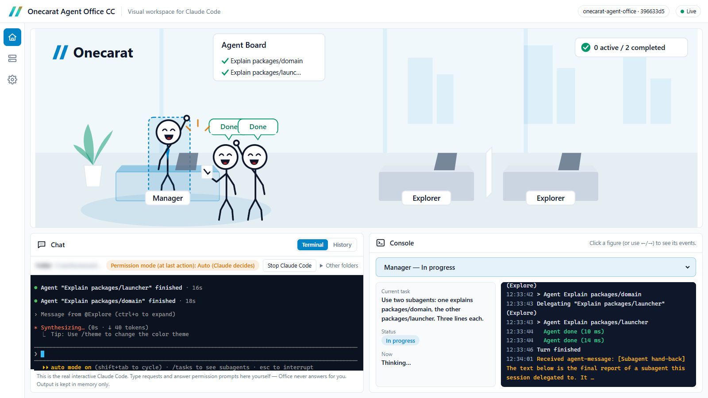

# Onecarat Agent Office CC

[English](README.md) | 日本語

> 早期公開版（v0.2.x）。Windows 11 と Claude Code 2.1.319 で動作を確認しています。

**Claude Code の作業を、ブラウザの小さなオフィスで「見える化」するコンパニオンアプリです。**
マネージャー（メインのエージェント）と、Claude Code が**実際に起動した**サブエージェントが、棒人間としてデスクで調査・編集・テストをし、終わると報告します。チャット欄は**本物の対話型 Claude Code が動く内蔵ターミナル**なので、依頼と観察が1つの画面で済みます。



**はじめに。** Claude Code は、Anthropic のターミナルで動く AI コーディングツールです。Office はそれを置き換えるものではなく、隣で動くコンパニオンです。Claude Code がインストールされ、サインイン済みであることが前提です。Claude Code は作業の一部を補助のエージェント（**サブエージェント**）に任せることがあり、オフィスに増える棒人間がそれです。

## インストール（2コマンド）

ターミナルで実行します。

```
claude plugin marketplace add onecarat-labs/onecarat-agent-office
claude plugin install onecarat-agent-office@onecarat
```

インストール後、Claude Code（ターミナル版、または Claude Code の Desktop app）で次のように頼むと起動します。

```
Onecarat Agent Officeを起動して
```

`/onecarat-agent-office:office start` と打っても同じです。ブラウザで http://127.0.0.1:47821/ が開きます（起動ごとのアクセス用キー付き。「プライバシー」を参照）。

## 必要なもの

| 項目 | 条件 |
|---|---|
| **Node.js** | **18 以上が必須**。Claude Code 本体とは別に必要です。入っていなければ https://nodejs.org/ の LTS を入れてください（Windows なら `winget install OpenJS.NodeJS.LTS`）。入れたら Claude Code（Desktop app も）を再起動してください。 |
| Claude Code | 2.1.139 以上（動作を確認したのは 2.1.319 のみ）。**インストールしてサインイン済み**であること。**Research Lab** は、動作確認済みが 2.1.323〜2.1.325 です。2.1.198 未満では動きません（公開の変更履歴による）。その間の版は未確認です。お使いの版は `check`（「困ったとき」参照）で確かめられます。Office は自分のアカウントを持たず、あなたの Claude Code をそのまま使うので、利用料が増えることはありません |
| OS | **Windows 11 で動作確認済み**。macOS / Linux は設計上は考慮していますが、実機テストが済むまでは保証しません。内蔵ターミナルは Windows（x64/arm64）と macOS 向けを同梱しています。Linux では当面、読み取り専用で動きます（Claude Code はいつものターミナルで使います）。 |

Node.js が無い状態でプラグインを入れても、Claude Code の動作は止まりません。Hook はバックグラウンドで動くもので、失敗として記録されるだけで、セッションを止めることはありません。Office を起動すると、Skill が Node.js のインストールを案内します。

## 使い方

- **チャット →「ターミナル」**で「ここで Claude Code を開始」を押すと、表示されているフォルダで本物の対話型 `claude` が起動します。既定のフォルダは Office を起動したセッションのフォルダです。そのボタンの隣の「…」メニューには「作業フォルダを変更」と「ターミナルの文字の大きさ」の 2 項目があり、それぞれ専用のダイアログが開きます。フォルダのダイアログでは、始め方（新しいセッション／前回の続きから／過去のセッションから選ぶ）と、開始するフォルダ（現在のフォルダ、ほかのセッションのフォルダ、入力したフォルダ）を選びます。「前回の続きから」はそのフォルダでいちばん最近の会話を開き（`claude --continue`）、「過去のセッションから選ぶ」は Claude Code 自身の過去の会話の一覧をターミナルに表示します（`claude --resume`）。依頼の入力も承認の操作も、ふつうのターミナルと同じようにそこで行います。上のオフィスはそのセッションを追いかけます。Claude Code がマウスを使っている間、右クリックは Claude Code だけに届きます。文字を選択したいとき、ブラウザのコピー／貼り付けのメニューを出したいときは、Shift を押しながら操作します。
- いつもどおり Claude Code を使うだけでもかまいません。ターミナル、IDE 拡張、Desktop app のどれでも同じように表示されます。
- 画面には、いちばん動いているセッションが表示されます。左の「セッション」ボタンで切り替えられます。
- 下の「コンソール」は、ふだんはセッション全体（だれが何をしているか、直近のイベント）を表示します。棒人間をクリックすると、そのエージェントの担当タスク・状態と、根拠になった実際のイベントに切り替わります。同じ棒人間をもう一度クリックすると全体に戻ります。棒人間の上のラベルは短い表現（「調査中」「実行中」など）で、マウスを重ねると詳しい内容が出ます。1回の依頼で作られたファイルが少ないとき（文書など。5個以下）は、コンソールに「作成したファイル」として並び、押すとそのフォルダが開きます。プログラム一式のように数が多いときは並べません。
- オフィス右上の件数表示（「2 稼働中 / 1 完了」）を押すと、タスク一覧が開きます。許可待ちがあるときは、ここに必ず表示されます。
- 停止は `Onecarat Agent Officeを止めて`（または `/onecarat-agent-office:office stop`）です。ブラウザのタブを閉じても Office は止まりません。内蔵ターミナルの Claude Code が終わると（`/exit` や「Claude Code を終了」ボタン）、数秒後に Office も自動で止まり、画面にはお別れの場面が残ります。ほかのターミナルのセッションが終わっても Office は止まりません。

### 表示の約束
- **架空のエージェントは出しません。** 棒人間は、Claude Code が実際に起動したサブエージェントの分だけです。
- **進捗率（%）は出しません。** 取得できないためです。表示するのは「調査中」「編集中」「テスト中」などの段階だけです。
- **成功・失敗は推定です**（Claude Code は成否を通知しないため）。画面にもそう表示します。ハイタッチは、推定で成功し、かつマネージャーが報告を受け取った場合の**演出**です。
- **承認の操作は必ず、あなた自身が Claude Code で行います**（内蔵ターミナルは Claude Code そのものです）。Office は承認プロンプトを読まず、解釈せず、応答もしません。あなたの代わりに送信することもありません（Research Lab の「調査開始」で、コマンド1行を入力欄に貼り付けることだけが例外です。Enter は押しません。下記）。
- チャット →「履歴」には、Hook から得た依頼と最終返答を表示します（読み取り専用）。

### Research Lab（調査モード）

オフィスの絵の左右にある「‹」「›」で、**Office** と **Research Lab** を切り替えられます。どちらも**同じ Claude Code のセッション**を映す画面です。切り替えるのは表示だけで、実行中のものを止めたり、新しく起動したりはしません。

Research Lab は、調査の成果が主役の画面です。上にマネージャーとリサーチャー全員、左に選んだ1人、右に **Findings Board** があり、成果が1件できるたびにカードが1枚増えます。ターミナルとコンソールは Office 画面にあります。

1. Research Lab で調査テーマを入れ、結果の件数（3 / 5 / 10 / 20）とリサーチャーの人数（1〜3）を選んで「調査開始」を押します。
2. Office が、調査用のコマンド1行を Office のターミナルの入力欄に**貼り付けて**、Office 画面に切り替えます。**Enter は押しません。** 内容を確かめて、そのターミナルで自分で Enter を押してください。
3. マネージャー（Claude Code の本体）が、プラグイン同梱の Skill に従ってリサーチャーをバックグラウンドで起動します。リサーチャーが登場したら、画面は Research Lab に戻ります。
4. リサーチャーは成果を1件ずつ、作業フォルダの `research/<調査ID>/` に書きます。Office はそれを読んでカードにします。カードには担当（R1、R2…）と、マネージャーの確認結果（確認済み／要確認）が付きます。

- **Office があなたの代わりに端末へ書くのは、この貼り付けだけです。** 「調査開始」を押した1回につき、コマンド1行を1回だけ貼り付けます。Enter、承認プロンプトへの応答、やり直しの入力はしません。
- 貼り付けるのは、Office のターミナルで Claude Code が動いていて、その開始を Hook で確認でき、承認待ちが無いときだけです。そうでないときは貼り付けず、コマンドを画面に出します（コピーして、お使いの Claude Code で実行できます）。ターミナルの出力は読みません。
- 自分でコマンド（`/onecarat-agent-office:research <件数> <人数> <テーマ>`）を打って始めた調査も、同じように表示します。外のターミナル・IDE・Desktop app でも構いません。
- **承認は、いつもどおりあなたが Claude Code で答えます。** リサーチャーの承認プロンプトも同じターミナルに出ます。権限モードが「毎回確認」のときは、検索ごと・サイトごと・書き込みごとに承認が出ます（結果1件につき5〜10回ほどが目安）。Office もプラグインも、権限を緩める設定は付けません。
- **人数を増やすと、その分だけ利用枠の消費が増えます。**
- **画面が自動で切り替わるのは2回だけ**です（貼り付けたあとの Office 画面への移動と、Research Lab への復帰）。復帰のときに承認待ちがあれば戻らず、「Research Lab を見る」ボタンを出します。Research Lab から Office 画面へは自動では移りません。自分で切り替えたあとは、その調査では自動で切り替えません。
- **「許可待ち」が残ることがあります。** 承認で No を選んだあとは Claude Code から何も届かないため、Office は結果を知ることができません。画面には「許可待ち（3分前から）」のように経過時間を出し、「この表示を消す」ボタンを付けています。このボタンは Office の表示だけを消します（Claude Code には何も送りません）。Office 画面でも同じです。
- **表示を消しても、貼り付けと自動の復帰の条件は変わりません。** 貼り付けてよい根拠は Claude Code から届くイベントだけです。承認の結果を Office は知ることができないので、次のイベント（入力、ツールの完了、ターン終了、セッション終了）が届くまでは、「調査開始」は貼り付けず、コピー用のコマンドを表示します。コマンドをコピーして、ご自身で貼り付けてください。
- **調査を止めるボタンはありません。** 止めるときは、Office 画面のターミナルで自分で操作します（Esc でマネージャーの作業を中断。バックグラウンドのリサーチャーは、ターミナルの一覧「↓ to manage」から止めます）。
- **完了は証拠があるときだけ表示します。** 調査は、まとめのファイル（`summary.json`）が書かれたときだけ「完了」です。書かれないまま終わった場合は「完了を確認できず」と表示します。進捗率は出しません。
- **調査結果は作業フォルダに残ります**（調査を実行したときだけ）。書くのは Claude Code で、Office は読むだけです。書き換えも削除もしません。読むのは、調査を実行したセッションの作業フォルダの `research/<調査ID>/` だけです。作業フォルダが Git の管理下なら `research/` が変更として現れることがあります（`.gitignore` は変更しません）。
- Office を再起動すると、保存済みの調査がボードに復元されます。復元されるのは、Office を起動したフォルダと、内蔵ターミナルで選んでいるフォルダの調査だけです。
- カードは実際に保存されたファイルからだけ作ります。指定の件数に届かなかった場合は、届かなかった件数をそのまま表示します。参照元は http / https の URL だけをリンクにし、本文は文字として表示します。
- ターミナルに「Unknown command」と出た場合、その Claude Code は調査用のコマンドをまだ読み込んでいません（プラグインの更新前から開いていた場合など）。Claude Code を開き直してください。このとき画面は「Enter 待ち」のまま残るので、「取り消す」で消してください。
## 仕組み

```
Claude Code（ターミナル / IDE / Desktop app）
   │ 公式の Hook（command 型・async、プラグインで登録）
   ▼
forward.mjs ── 必要な項目だけを抜き出して POST（Office 停止中は何もしない）
   ▼
ブリッジ（127.0.0.1:47821、メモリ上のみ）── イベント ──▶ ブラウザの Office UI
   └─ 内蔵ターミナル：疑似端末（node-pty）上の claude ◀── WebSocket ──▶ xterm.js
```

- **Office はモデルを呼びません。** Anthropic API、Agent SDK、`claude -p` は使わないので、**追加の利用料はかかりません**。ただし、ほかのプラグインの Skill と同じく、Skill の短い説明文（数十トークン程度）は毎セッションのコンテキストに含まれます。
- 認証情報（`~/.claude/.credentials.json` など）は**読みません**。
- **設定**（左の歯車のアイコン）は、メニュー・一覧・詳細の 3 ペインです。「Office」には Office 自身の表示設定（テーマ、アニメーション、言語、文字の大きさ、ターミナルの文字の大きさ、エリアの大きさ）があります。「Claude Code」では、Claude Code が設定を読む場所をすべて、種類ごとに役割の説明つきで一覧にし、開いたときに現在の内容を**読み取り専用**で表示します。秘密に見える値と `env`/`headers` の中身は伏せます。`~/.claude.json` からは MCP サーバーと、このプロジェクトの許可だけを読みます。Office はこれらのファイルを編集しません。変更は Claude Code に頼んでください。

詳しくは [docs/architecture.md](docs/architecture.md) と [docs/security.md](docs/security.md)（いずれも英語）を見てください。

## プライバシー

- 通信はすべて**自分の PC の中**（127.0.0.1）だけです。外部送信やテレメトリーはありません。
- プロンプト・応答・コマンドの抜粋・**ターミナルの出力**は、**メモリ上で表示するだけで、ディスクには保存しません**。Office を止めると消えます。画面から消すこともできます。
- イベント・ターミナル・操作のすべてを、**起動ごとに作る1つのアクセス用キー**で守っています。ランチャーはこのキーを URL の `#t=…` の部分に入れてブラウザに渡します。この部分はサーバーに送られず、ページはすぐにアドレスバーから消します。キーがどこかに表示されることもありません。**内蔵ターミナルがあるため、このキーがあれば Claude Code に入力できてしまいます。URL は人に渡さないでください。** 詳しくは [docs/security.md](docs/security.md)（英語）。
- ファイルの**中身**は Office に送りません（ファイル名だけです。書かれたファイルの場所は手元のブリッジの中だけに置くので、ページが場所を知らなくても「フォルダを開く」が使えます）。例外は Research Lab の調査結果（`research/<調査ID>/` の JSON）で、これは Office が読んでカードにします。調査結果は Claude Code が作業フォルダに保存するので、Office を止めても残ります。

## 更新・無効化・アンインストール

```
claude plugin marketplace update onecarat           # 一覧を更新
claude plugin update onecarat-agent-office@onecarat # プラグインを更新
claude plugin disable onecarat-agent-office@onecarat   # 一時的に止める（Hook も止まる）
claude plugin uninstall onecarat-agent-office@onecarat # 削除
claude plugin marketplace remove onecarat             # marketplace の登録も消す
```

Office は `~/.claude/settings.json` を直接編集しません。プラグインを外せば Hook も外れます。PC に残るのは、起動中だけ作られる `%LOCALAPPDATA%\onecarat-agent-office\bridge.json`（ポート番号と、起動ごとのアクセス用キー）だけで、停止すると消えます。

## 困ったとき

| 症状 | 対処 |
|---|---|
| 「Node.js が必要」と言われる | Node.js 18 以上を入れ、Claude Code を再起動する |
| ポート 47821 が使用中 | `/onecarat-agent-office:office start --port 47822` |
| 何も表示されない | インストール前に始めたセッションは表示されません。新しいセッションを始めてください。それでも出なければ、状態の確認（`/onecarat-agent-office:office status`）と、プラグインが有効かの確認（`claude plugin list`） |
| 強制終了したあとに起動できない | `/onecarat-agent-office:office stop` で後片付けしてから `start` |
| ページに「キーなし」と出る | URL を手で開いたためです。「Onecarat Agent Officeを開いて」と頼むか、`/onecarat-agent-office:office open` を実行してください |
| 「内蔵ターミナルを使えません」と出る | この OS／CPU 向けの node-pty が無い（いまは Linux）か、PATH に `claude` が無い場合です（`/onecarat-agent-office:office check` でどちらか分かります）。表示はすべて動くので、Claude Code はいつものターミナルで使ってください |

## 開発

```
npm install
npm test            # 単体テスト・ブリッジ・転送スクリプト
npm run typecheck
npm run bridge -- --open                                   # ソースからブリッジを起動し、ビルド済み UI をキー付きで開く
npm run bridge -- --open --dev-origin http://127.0.0.1:5317 --open-base http://127.0.0.1:5317/
npm run dev                                                # （上の行と組み合わせて）5317 番で Vite の開発サーバー
npm run build:plugin  # plugin/onecarat-agent-office/dist を再生成（CI がソースとの一致を確認）
npm run vendor:check  # dist/vendor/node-pty が上流の npm tarball と一致するか（CI でも確認）
```

ディレクトリ：`packages/domain`（共通モデル）、`packages/adapter-claude-code`（Hook の正規化）、`packages/event-bridge`、`packages/office-ui`、`packages/launcher`、`plugin/onecarat-agent-office`（配布物）、`docs/`（アーキテクチャ・セキュリティ・機能対応表・テスト計画）。

## ライセンス

コードは [MIT License](LICENSE) です。

**「Onecarat」の名称・ロゴ・ブランド素材は MIT ライセンスの対象外です。** コードは自由に使って・改変して・配布してかまいませんが、派生物で Onecarat の名称やロゴを、公式であるかのように使わないでください。

Claude および Claude Code は Anthropic の製品です。本プロジェクトは Anthropic の公式製品ではありません。
