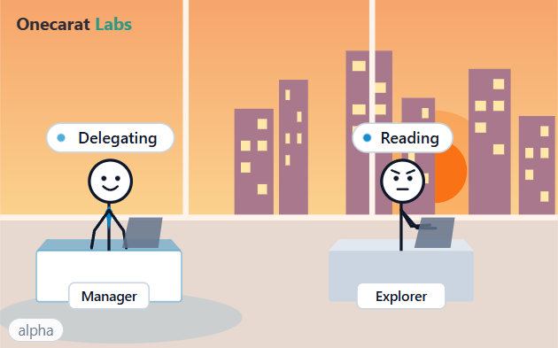
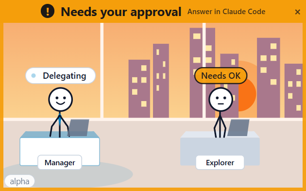
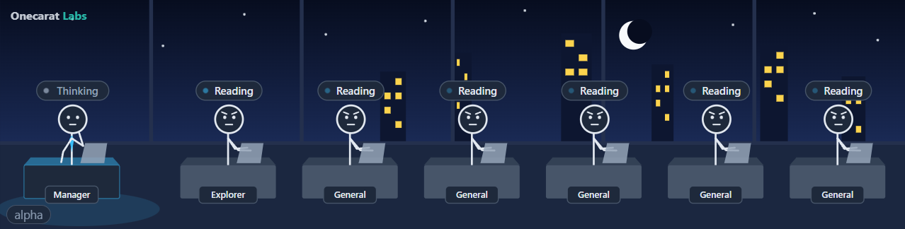

# Onecarat Agent Office

[日本語](README.ja.md) | English

A tool for watching Claude Code at work, in a small window at the top right of the screen. The main agent, and the subagents Claude Code really starts, work in an office as stick figures.

**It is a window for watching only.** You cannot type into Claude Code from it, and you cannot approve anything from it. You keep working in Claude Code in PowerShell, as before.



| Waiting for approval | Night |
|---|---|
|  |  |

## What it does

- **You can see what the agents are doing.** Thinking, reading files, editing, running commands, reporting: the figures' gestures and small labels show it.
- **A wait for approval is plain at a glance.** When Claude Code stops and waits for your approval, a "Needs your approval" banner appears at the top of the window and an orange frame blinks around it. The title bar says so too.
- **Japanese and English.** The window is in Japanese when the Windows display language is Japanese, and in English otherwise. This is automatic; there is no setting for it.
- **The background follows the time.** It changes with the PC's clock: morning, day, evening, night.
- **It can be put away in the taskbar.** Like any app, the window has a minimize button and comes back from the taskbar. If a wait for approval starts while it is put away, its taskbar button lights up to tell you. The maximize button is shown greyed out and does nothing (the standard Windows frame draws it next to the minimize button whenever minimizing is enabled).
- **The window can be moved and resized.** A larger window has more desks. Subagents that do not fit are shown as a number, such as "+3".
- **One window per session.** Run four Claude Code sessions and four small windows line up. The title bar and the folder name at the bottom left tell you which window belongs to which session.
- **Always on top.** It is never hidden under other windows. A new window does not take the keyboard away from where you are typing.

## What it does not do

This version is limited to "a small window for watching". It cannot do the following.

- Typing, requesting or sending anything from the window
- Approving or refusing from the window
- Saving what a session contains (prompts, output, file contents). Events are kept in memory only and are gone when the window closes
- Calling a model, or talking to anything outside your PC
- Running on macOS or Linux (it is for Windows only)
- Showing the office in a browser tab (a feature of earlier versions; see below)

## Requirements

- Windows 10 / 11
- Claude Code
- Node.js 18 or newer (if it is not installed: `winget install OpenJS.NodeJS.LTS`)

## Installation

Run these two lines in PowerShell.

```powershell
claude plugin marketplace add onecarat-labs/onecarat-agent-office
claude plugin install onecarat-agent-office@onecarat
```

Then restart Claude Code.

## Starting and stopping

In Claude Code, type either of these.

```
Start Onecarat Agent Office
```

```
/onecarat-agent-office:office start
```

A small window opens at the top right of the screen. After that, just use Claude Code as usual.

| To | Type |
|---|---|
| Start | `/onecarat-agent-office:office start` |
| Stop | `/onecarat-agent-office:office stop` (or close every small window) |
| See whether it is running | `/onecarat-agent-office:office status` |
| Check the environment | `/onecarat-agent-office:office check` |

Good to know:

- **Closing the last small window ends the app.** Start it again when you want to watch again.
- **When a session ends, its window closes by itself.** The figures bow and wave first.
- **A window you closed yourself does not reopen by itself during that session.** To bring it back, start the office once more.
- Right after starting, the window says "Waiting for Claude Code…" until the first event arrives (in Japanese: 「Claude Code の動きを待っています」).

## Reading the window

| What you see | What it means |
|---|---|
| The figure with a tie (left) | The main agent (the manager) |
| The figures at the desks on the right | Subagents that Claude Code really started |
| Label "Thinking" | Deciding what to do next |
| Labels "Reading", "Editing", "Running", "Testing", "Research" | Reading files, changing them, running a command, running tests, looking something up on the web |
| Label "Delegating" | The manager is giving work to a subagent |
| Label "Needs OK" (orange), with the banner at the top and the frame around the window | **Claude Code is waiting for your approval.** Answer in Claude Code |
| Label "Retrying", sweat | A tool failed and is being tried again |
| Walking to the manager, then a high five | A subagent finished its report (whether it succeeded is an estimate made from the events) |
| A bow, then leaving | The subagent's work is over |
| "+3" at the top right | Three more subagents are at work but do not fit in the window. Widen the window to see them |

The background follows the PC's clock: morning from 5:00, day from 10:00, evening from 16:00, night from 19:00.

When the window is in Japanese, the labels are 考え中 (Thinking), 調査中 (Reading), 編集中 (Editing), 実行中 (Running), テスト中 (Testing), 調べ中 (Research), 指示中 (Delegating), 承認待ち (Needs OK) and やり直し中 (Retrying). The banner at the top says 「承認待ち」.

### When the approval display stays

Claude Code does not tell the window that you chose "No". So the approval display stays after a refusal.

- If Claude Code went on working after the refusal, the display goes away within a few seconds.
- If the refusal also interrupted the work, the display stays until you send your next request.

## Turning the hooks on and off

The window receives its events from Claude Code's hooks (a mechanism that calls a command at fixed moments).

- **Turning them on**: installing the plugin as described under "Installation" enables the plugin's hooks. This tool never rewrites your settings files (`settings.json` and the like).
- **Pausing**: `claude plugin disable onecarat-agent-office@onecarat` (`enable` to use it again)
- **Removing**:

  ```powershell
  claude plugin uninstall onecarat-agent-office@onecarat
  claude plugin marketplace remove onecarat
  ```

- **Updating**:

  ```powershell
  claude plugin marketplace update onecarat
  claude plugin update onecarat-agent-office@onecarat
  ```

While the small-window app is not running, the hooks do nothing (and connect to nothing). While it is running, they are set to run in the background (`async`), so they never make Claude Code wait or stop. Which events are used is listed in [docs/hook-events.md](docs/hook-events.md) (in Japanese).

## Safety

- The app listens only inside your own PC (`127.0.0.1`). It talks to nothing outside.
- The hooks send only the fields needed to move the figures. No text of your work is sent: no prompt you wrote, no command, no file name or file contents, no URL, no search words, no tool output, no error message. Of a command, only whether it runs tests is sent. The one text that is sent is the folder Claude Code runs in; its last part is the window's title.
- Received events are kept in memory only. Nothing is saved to disk.
- There is no path from the window to Claude Code.
- The component that shows the window (Microsoft Edge WebView2) keeps a cache of its own in `%LOCALAPPDATA%\com.onecarat.agent-office`. It contains nothing of your sessions.

How it works is explained in [docs/architecture.md](docs/architecture.md) (in Japanese). For reporting a vulnerability, see [SECURITY.md](SECURITY.md).

## Troubleshooting

| Symptom | What to check |
|---|---|
| No window appears | Run `/onecarat-agent-office:office check` and read what it says |
| It says "port … is in use" (in Japanese: 「ポート … が使われています」) | An Office of an earlier version may still be running. Stop it and start again, or try `/onecarat-agent-office:office start --port 47822` |
| The window appears but the figures do not move | Did you restart Claude Code after installing the plugin? Check with `claude plugin list` that it is enabled |
| Windows shows a warning on the first start | The small-window app (`onecarat-agent-office.exe`) is not code-signed. Check where you got it from before you decide |

## Earlier versions (the office in a browser tab)

Up to version 0.3.0, the office opened in a browser tab, where you could also type requests, run research (Research Lab) and list settings. Version 1.0 limits the scope to "a small window for watching" and removes those features. Features that reach into Claude Code have to keep up with every change of Claude Code, and the author could no longer keep that up.

The earlier versions remain in the releases `v0.3.0` and before of the public repository.

## For developers

```powershell
npm ci
npm test              # events to state, the rules of the picture, the launcher
npm run typecheck
npm run test:app      # the small-window app (Rust)
npm run build:plugin  # builds the page, the app and the launcher into the plugin's dist
```

Building the app needs Rust (the MSVC toolchain). Layout:

| Where | What |
|---|---|
| `packages/domain` | How the state is kept, and how events become state (the part that depends on no tool) |
| `packages/adapter-claude-code` | Turns the input of Claude Code's hooks into those events |
| `packages/office-ui` | The page in the small window (React and SVG): figures, background, the approval display |
| `packages/launcher` | The launcher (start / stop / status / check) |
| `src-tauri` | The small-window app itself (Tauri, Rust): where hooks arrive, and which window shows which session |
| `plugin/onecarat-agent-office` | The Claude Code plugin (hook registration, the forwarder script, the skill, the built `dist`) |
| `tests/app` | A check that starts the real app on another port (`npm run build:inspect`, then `npm run check:app`; for the English display, `node tests/app/check-app.mjs --lang en`) |

The words of the window, the title bar and the launcher are kept in one place, in Japanese and English: `packages/domain/src/i18n.ts`.

The Japanese README ([README.ja.md](README.ja.md)) is the original; this English one is its translation.

## License

MIT License ([LICENSE](LICENSE))
