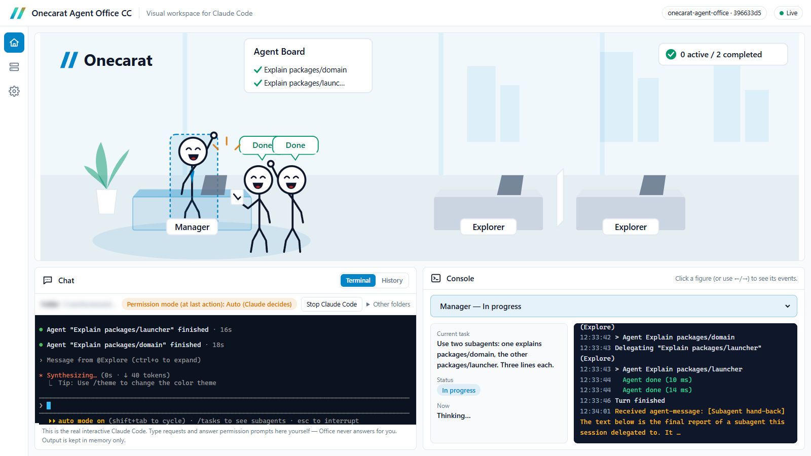

# Onecarat Agent Office CC

English | [日本語](README.ja.md)

> Early release (v0.2.x). Verified on Windows 11 with Claude Code 2.1.319.

**A companion app that turns Claude Code's work into a small office you can watch in your browser.**
The manager (main agent) and the subagents Claude Code **actually starts** appear as stick figures that research, edit and test at their desks, then report back. The chat panel is a **built-in terminal running the real interactive Claude Code**, so you can ask and watch on one screen.



**What you need to know first.** Claude Code is Anthropic's AI coding tool that runs in a terminal. Office does not replace it; it runs beside it, so Claude Code must be installed and signed in. While working, Claude Code sometimes hands parts of a job to helper agents (*subagents*); the extra figures in the office are those.

## Install (2 commands)

Run in a terminal:

```
claude plugin marketplace add onecarat-labs/onecarat-agent-office
claude plugin install onecarat-agent-office@onecarat
```

Then ask Claude Code (in the terminal, or in Claude Code's Desktop app):

```
Start Onecarat Agent Office
```

or type `/onecarat-agent-office:office start`. Your browser opens http://127.0.0.1:47821/ (with a per-launch access key; see Privacy).

## Requirements

| | |
|---|---|
| **Node.js** | **18 or newer, required.** It is separate from Claude Code itself. If missing, install the LTS from https://nodejs.org/ (Windows: `winget install OpenJS.NodeJS.LTS`) and restart Claude Code / the Desktop app. |
| Claude Code | 2.1.139 or newer (tested on 2.1.319 only), **installed and signed in**. **Research Lab**: checked on 2.1.323 to 2.1.325; it does not work below 2.1.198 (according to the public changelog); versions in between are untested. `check` (see Troubleshooting) tells you where your version stands. Office has no account of its own: it uses your Claude Code as it is, and adds no usage or cost |
| OS | **Tested on Windows 11.** macOS / Linux are designed for but not guaranteed until tested. The built-in terminal ships for Windows (x64/arm64) and macOS; on Linux Office runs read-only for now (use Claude Code in your own terminal). |

Installing the plugin without Node.js does not break Claude Code: the hooks are background hooks, so they are only recorded as failed and never block a session. When you start Office, the skill tells you how to install Node.js.

## Use

- **Chat → Terminal**: press "Start Claude Code here". The real interactive `claude` starts in the folder shown (by default, the folder of the session that started Office). The "…" menu next to that button has two items, each opening its own dialog: "Change working folder" and "Terminal text size". In the folder dialog you choose how to start (new session, continue, pick a past session) and where (the current folder, a folder of another session, or one you type). "Continue last session" reopens the most recent conversation of that folder (`claude --continue`), and "Pick a past session" shows Claude Code's own list of past conversations in the terminal (`claude --resume`). Type requests and answer permission prompts there, as in any terminal. The office above follows that session. While Claude Code uses the mouse itself, a right click goes to Claude Code only; hold Shift to select text or to open the browser's copy / paste menu.
- Or just use Claude Code as usual: terminal, IDE extension or Desktop app all show up the same way.
- The most active session is shown; switch with the Sessions button on the left.
- The Console panel shows the whole session (who is doing what, latest events). Click a figure to see that agent's task, state and the real events behind it; click it again to go back to the overview. The label above a figure is short ("Reading", "Running"); hover for the full wording. When a request wrote only a few files (a document; five or fewer), they are listed in the Console as "Files created", and a click opens their folder. Requests that wrote many files (a whole program) are not listed.
- The counter at the top right of the office ("2 active / 1 completed") opens the task list. A permission wait is always shown on it.
- Stop with "Stop Onecarat Agent Office" or `/onecarat-agent-office:office stop`. Closing the tab does not stop it. When Claude Code in the built-in terminal ends (`/exit`, the Stop button), Office stops by itself a few seconds later; the page keeps the goodbye scene. Sessions in other terminals do not stop Office.

### What the screen promises
- **No fake agents.** A figure appears only for a subagent Claude Code really started.
- **No made-up percentages.** Progress is not available, so only stages are shown (reading, editing, testing…).
- **Success/failure is an estimate** (Claude Code does not report it) and is labelled as such. The high-five is a **visual effect** for an estimated success the manager has received.
- **Permission prompts are always answered by you in Claude Code** (the built-in terminal *is* Claude Code). Office never reads, parses or answers them, and never sends anything for you (the one exception: "Start research" in Research Lab pastes one command line into the input box, without Enter; see below).
- Chat → History shows the requests and final replies taken from the hooks (read-only).

### Research Lab

The "‹" and "›" buttons on the office picture switch between **Office** and **Research Lab**. Both are views of **the same Claude Code session**. Only the view changes: nothing is started, stopped or reset by switching.

Research Lab is about what was found. The manager and all researchers are at the top, the one you pick is on the left, and the **Findings Board** is on the right; every finished finding adds one card. The terminal and the console are in the Office view.

1. In Research Lab, enter a theme, choose how many findings (3 / 5 / 10 / 20) and how many researchers (1 to 3), and press "Start research".
2. Office **pastes** one command line into the input box of the Office terminal and shows the Office view. **It does not press Enter.** Check the line and press Enter in that terminal yourself.
3. The manager (Claude Code's main conversation) follows the skill shipped with the plugin and starts the researchers in the background. Once they have appeared, the page goes back to Research Lab.
4. Each researcher saves its findings one by one into `research/<research id>/` in the working folder. Office reads these files and shows them as cards. A card carries who wrote it (R1, R2…) and the manager's check (confirmed / needs check).

- **This paste is the only thing Office ever writes into a terminal for you.** Once per press of "Start research": one command line. No Enter, no answer to a permission prompt, no retry.
- It is pasted only when Claude Code runs in the Office terminal, a hook has shown that it started, and nothing waits for approval there. Otherwise nothing is pasted and the command is shown on the page (copy it and run it in your Claude Code). Terminal output is never read.
- A research you start by typing the command yourself (`/onecarat-agent-office:research <findings> <researchers> <theme>`) is shown the same way, also from another terminal, an IDE or the Desktop app.
- **You answer the permission prompts in Claude Code, as always.** The researchers' prompts appear in the same terminal. In the "ask each time" mode Claude Code asks for each search, each site and each file it writes (about 5 to 10 times for one finding). Neither Office nor the plugin adds anything that loosens permissions.
- **More researchers use that much more of your usage allowance.**
- **The view changes by itself only twice**: to the Office view after the paste, and back to Research Lab. If something waits for approval at that moment, it does not go back and offers a "See the Research Lab" button instead. It never moves from Research Lab to the Office view by itself. Once you switch the view yourself, nothing is switched automatically for that research.
- **A "waiting for permission" can stay on the page.** When you refuse a prompt, Claude Code sends nothing, so Office cannot know how it ended. The page shows how long the wait has been there ("for 3 min") and a "Hide this wait" button. The button changes the Office page only (nothing is sent to Claude Code). The Office view has the same.
- **Hiding a wait does not change when Office pastes or goes back by itself.** Only events from Claude Code count as evidence. Office cannot know how a permission request ended, so until the next event arrives (a prompt, a finished tool call, the end of the turn or of the session), "Start research" does not paste and shows the command for copying instead: copy it and paste it yourself.
- **There is no button that stops a research.** To stop one, use the terminal in the Office view yourself (Esc interrupts the manager; background researchers are stopped from the terminal's "↓ to manage" list).
- **"Done" needs evidence.** A research is done only when its summary file (`summary.json`) was written; if it ended without one, the page says "end not confirmed". No progress percentage is shown.
- **Research results stay in your working folder** (only when you ran a research). Claude Code writes them; Office only reads them and never changes or deletes them. It reads only `research/<research id>/` in the working folder of the session that ran the research. In a Git working tree `research/` may show up as a change (`.gitignore` is not touched).
- After a restart, saved researches are shown on the board again, but only those of the folder Office was started in and of the folder chosen in the built-in terminal.
- Cards are made only from files that were really saved. If fewer findings than requested were saved, the board says how many are missing. Only http / https sources are links; card text is shown as plain text.
- If the terminal shows "Unknown command", that Claude Code has not loaded the research command yet (for example, it was opened before the plugin was updated): reopen Claude Code. The page then still says "Press Enter"; remove that with "Drop it".
## How it works

```
Claude Code (terminal / IDE / Desktop app)
   │ official hooks (command, async; registered by the plugin)
   ▼
forward.mjs ── keeps only the fields Office shows, POSTs them (does nothing if Office is not running)
   ▼
bridge (127.0.0.1:47821, memory only) ── events ──▶ Office UI in your browser
   └─ built-in terminal: claude in a pseudo-terminal (node-pty) ◀── WebSocket ──▶ xterm.js
```

- **Office never calls a model.** No Anthropic API, Agent SDK or `claude -p`, so **it adds no extra cost.** Like any plugin skill, its short skill description (a few dozen tokens) is part of each session's context.
- It **never reads credentials** (`~/.claude/.credentials.json` etc.).
- **Settings** (gear icon on the left) has three panes: menu, list and detail. "Office" holds Office's own display settings (theme, motion, language, text size, terminal text size, area sizes). "Claude Code" lists every place Claude Code reads settings from, grouped by topic, with what each is for, and shows the current content **read-only** when you open it. Secret-looking values and everything under `env`/`headers` are hidden; from `~/.claude.json` only the MCP servers and the current project's permissions are read. Office never edits these files: ask Claude Code to change them.

See [docs/architecture.md](docs/architecture.md) and [docs/security.md](docs/security.md).

## Privacy

- All traffic stays **on your machine** (127.0.0.1). No telemetry, no cloud.
- Prompts, replies, command snippets and **terminal output** are **shown from memory and never written to disk**; they are gone when Office stops (or when you clear them in the UI).
- **One access key per launch** protects everything (events, terminal, controls). The launcher hands it to your browser in the URL fragment (`#t=…`), which is never sent to the server, and the page removes it from the address bar. Nothing prints it. **With the built-in terminal, that key can type into Claude Code: never share the URL.** Details: [docs/security.md](docs/security.md).
- File **contents** are never sent to Office (only file names; where a written file is stays inside the local bridge, so "open folder" works without the page knowing the path). The exception is Research Lab results (the JSON files in `research/<research id>/`), which Office reads to show the cards. Claude Code saves them in your working folder, so they remain after Office stops.

## Update / disable / uninstall

```
claude plugin marketplace update onecarat
claude plugin update onecarat-agent-office@onecarat
claude plugin disable onecarat-agent-office@onecarat    # pause (hooks stop too)
claude plugin uninstall onecarat-agent-office@onecarat
claude plugin marketplace remove onecarat
```

Office never edits `~/.claude/settings.json` directly; removing the plugin removes its hooks. The only file it creates is `%LOCALAPPDATA%\onecarat-agent-office\bridge.json` (port + per-launch access key) while it runs; it is deleted on stop.

## Troubleshooting

| Symptom | Fix |
|---|---|
| "Node.js is required" | Install Node.js 18+, restart Claude Code |
| Port 47821 in use | `/onecarat-agent-office:office start --port 47822` |
| Nothing shows up | Sessions started before the plugin was installed are not shown: start a new session. Then check `/onecarat-agent-office:office status` and `claude plugin list` |
| Cannot start after a crash | `/onecarat-agent-office:office stop`, then `start` |
| "No access key" in the page | You opened the URL by hand. Ask "Open Onecarat Agent Office" or run `/onecarat-agent-office:office open` |
| "Built-in terminal is not available" | No node-pty binary for this OS/CPU (Linux today), or no `claude` on PATH (`/onecarat-agent-office:office check` prints which). Office still shows everything; use Claude Code in your own terminal |

## Development

```
npm install
npm test
npm run typecheck
npm run bridge -- --open                                   # bridge from source, opens the built UI with its key
npm run bridge -- --open --dev-origin http://127.0.0.1:5317 --open-base http://127.0.0.1:5317/
npm run dev                                                # (with the line above) Vite dev server on 5317
npm run build:plugin  # regenerate plugin/onecarat-agent-office/dist (CI checks it matches the source)
npm run vendor:check  # dist/vendor/node-pty must equal the upstream npm tarball (CI too)
```

Directories: `packages/domain` (shared model), `packages/adapter-claude-code` (hook normalization), `packages/event-bridge`, `packages/office-ui`, `packages/launcher`, `plugin/onecarat-agent-office` (what is shipped), `docs/` (architecture, security, event support matrix, test plan).

## License

Code: [MIT License](LICENSE).

**The "Onecarat" name, logo and brand assets are not covered by the MIT License.** You may use, modify and redistribute the code, but do not use the Onecarat name or logo in a way that suggests your fork is official.

Claude and Claude Code are products of Anthropic. This project is not an official Anthropic product.
